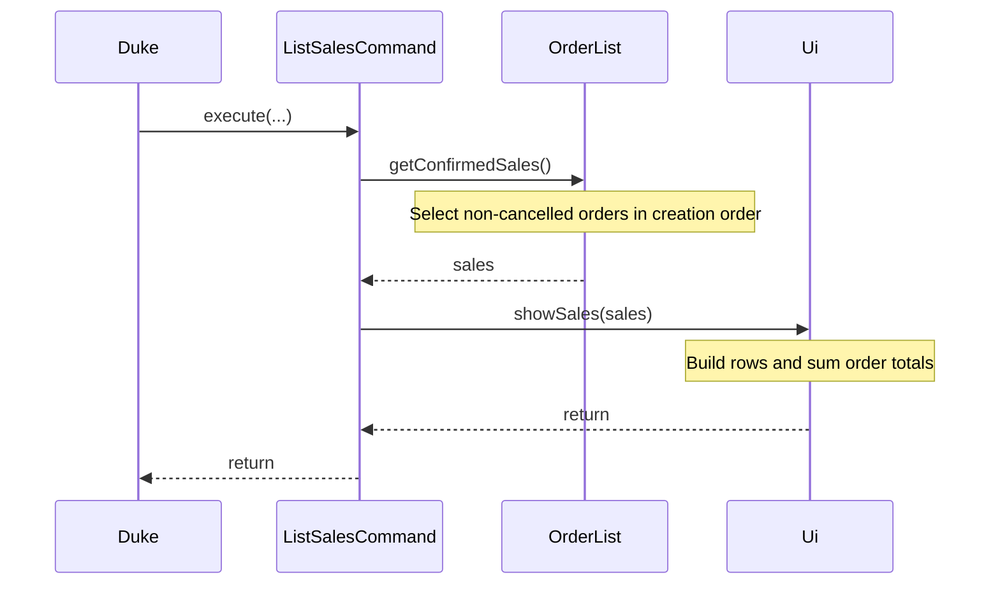
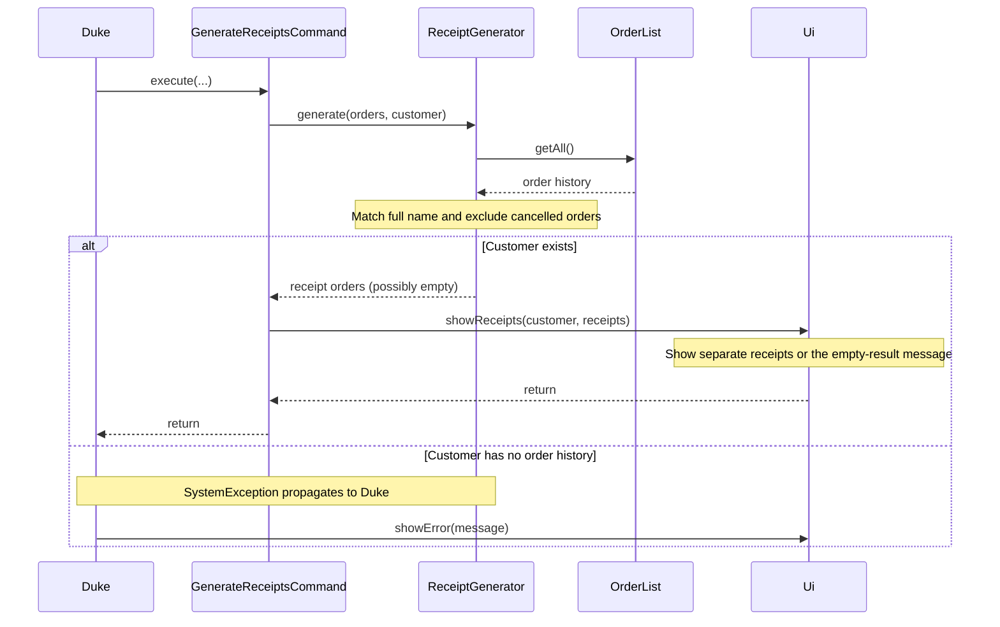
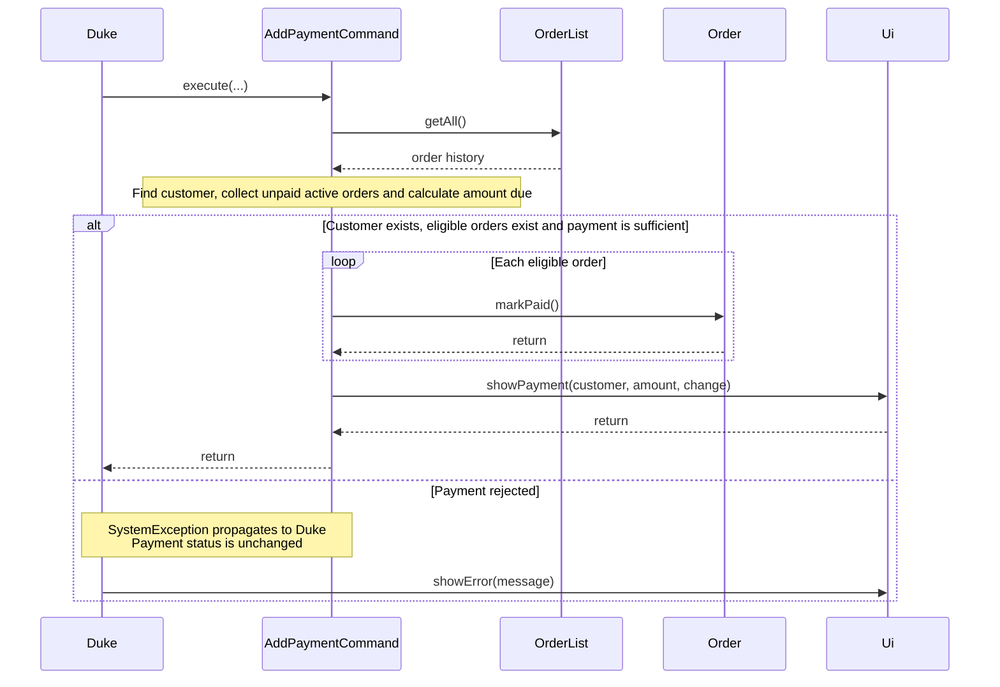
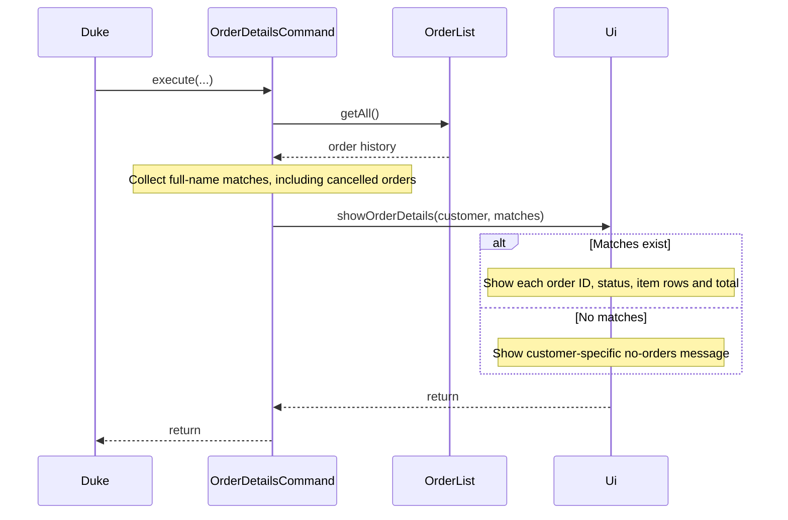
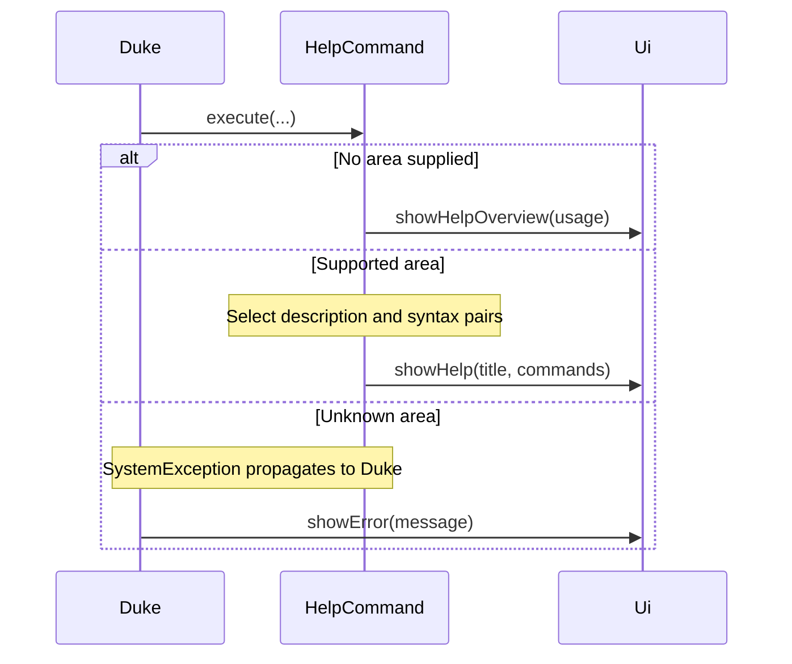
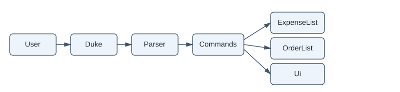
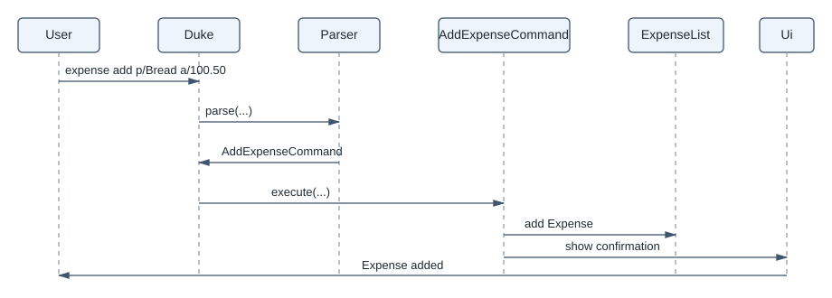
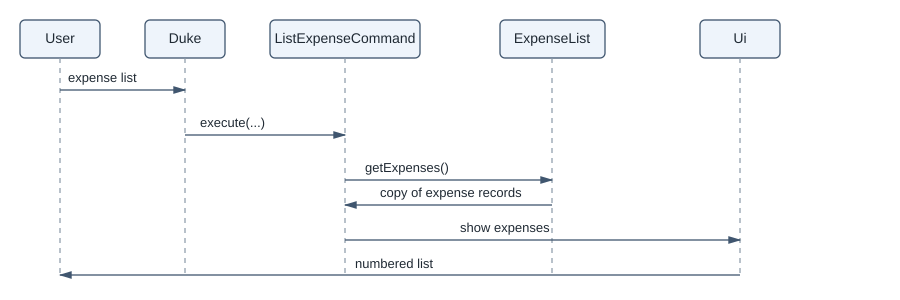
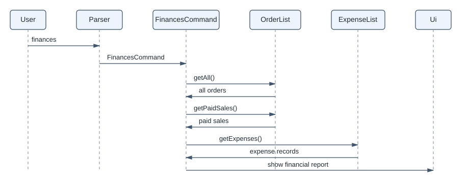

# Developer Guide

## Acknowledgements

{list here sources of all reused/adapted ideas, code, documentation, and third-party libraries -- include links to the original source as well}

* **AI assistance (Brian Yang, @zechby):** Claude (Anthropic) was used to add the assertions and logging in
  `Product`, `ProductList` and `AddProductCommand`, the related `ProductTest` cases, and the first draft of the
  product catalogue sections of the User Guide.

## Design & implementation

{Describe the design and implementation of the product. Use UML diagrams and short code snippets where applicable.}

### Orders

The order feature records what customers buy and keeps stock in step with it. It supports five commands:
`order add`, `order cancel`, `order list`, `order edit` and `order discount`.

* `OrderList` stores every order and hands out order numbers. Numbers start at 1 and only go up, so a number
  always refers to the same order, even after it is cancelled.
* `Order` holds a customer, one or more `OrderItem`s, a cancelled flag and a discount percentage.
* `OrderItem` is one line of an order: a `Product`, a quantity and the unit price paid. The unit price is copied
  from the product when the line is created, so a later price change does not alter what a past order says the
  customer paid.
* Each command is its own `Command` subclass. `Parser` validates the input, so commands only ever receive
  well-formed values. A command checks the rules that depend on stored data, such as whether an order exists or
  stock is sufficient.

#### Adding an order

`order add c/CUSTOMER p/PRODUCT q/QUANTITY [p/PRODUCT q/QUANTITY]...` is handled by `Parser#parseAddOrder` and
`AddOrderCommand`.

**Parsing.** Unlike `product add`, `p/` and `q/` may appear many times here, and each `q/` belongs to the `p/`
just before it. So the parser cuts the arguments into (prefix, value) pairs in the order they were typed, then
checks them in sequence: one `c/` first, followed by one or more `p/ q/` pairs. A prefix only counts when it is
at the start or after a space, so a product named `Salt and Pepper Mix 1c/2` is not split in the middle. A
product named twice in one order is rejected. On their own, two lines for the same product could each pass the
stock check while together asking for more than is in stock.

**Execution.** `AddOrderCommand` works in two passes:

1. *Check.* Look up every product and check its stock. If any line fails, a `SystemException` is thrown before
   anything has changed.
2. *Apply.* Deduct each quantity from stock, build the `OrderItem`s, and call `OrderList#create`, which assigns
   the next order number.

**Design considerations.**

* *All-or-nothing vs. partial orders.* Accepting the valid lines and dropping the rest would leave the user
  unsure what was recorded. Rejecting the whole order keeps stock and the order list predictable.
* *Copying the unit price vs. reading it from the product.* Reading the price from `Product` each time would be
  simpler, but would change the totals of past orders whenever a price changes.

#### Cancelling an order

`order cancel ORDER_NUMBER` is handled by `Parser#parseCancelOrder` and `CancelOrderCommand`.

The command finds the order, calls `Order#cancel()`, then returns each line's quantity to stock. `cancel()` runs
first because it throws if the order is already cancelled, so stock can never be restored twice. The order stays
in `OrderList`, marked as cancelled. `sales list` uses `OrderList#getConfirmedSales()`, which leaves cancelled
orders out, and `ReceiptGenerator` skips them too.

**Design considerations.**

* *Marking as cancelled vs. deleting.* Deleting the order would either leave an unexplained gap in the numbering
  or let a number be reused for a different order. Keeping it, marked `Cancelled`, preserves the history and
  keeps every number unique.

#### Listing orders

`order list` is handled by `ListOrderCommand`, which passes `OrderList#getAll()` to `Ui#showOrders`. The list is
returned as a read-only view, so a caller cannot add or remove orders except through `OrderList`. `Ui` works out
each order's units and status, and sizes each table column to its longest value, so long names widen the table
instead of breaking its alignment.

**Design considerations.**

* *Showing vs. hiding cancelled orders.* Cancelled orders are shown with their status, so the numbers in the list
  always run 1, 2, 3... For sales figures that exclude them, `sales list` uses `getConfirmedSales()`.

#### Editing an order

`order edit ORDER_NUMBER [c/CUSTOMER] [p/PRODUCT] [q/QUANTITY]` is handled by `Parser#parseEditOrder` and
`EditOrderCommand`.

**Parsing.** The parser reads the order number, then cuts the rest into (prefix, value) pairs. It recognises
every prefix the system uses (`a/`, `c/`, `d/`, `p/`, `q/`), not just the three `order edit` supports, so that
`order edit 2 d/10` is rejected rather than read as part of a name. Each prefix may appear at most once. Fields
that are left out are passed to the command as `null`, meaning "keep the current value".

**Execution.** The command runs in two passes, like `AddOrderCommand`:

1. *Check.* Find the order, reject it if it is missing or cancelled, then work out the new order line in
   `planLineChange`: look up the replacement product (if any), and check that stock can cover the change.
   For the same product, only the extra units (new quantity minus old quantity) must be in stock. For a
   different product, the full new quantity must be in stock.
2. *Apply.* Return the old line's units to stock, take the new line's units out, and call `Order#update`.

Because nothing changes until every check has passed, a failed edit needs no rollback. An assertion after the
stock movement checks that units were only moved, never created or lost.

The unit price follows the product. An unchanged product keeps the price stored on the order line (through the
`OrderItem(Product, int, double)` constructor), so a customer is not re-priced by an edit. A replacement product
uses its current catalogue price.

**Design considerations.**

* *Multi-product orders.* `p/` and `q/` cannot say which line of a multi-product order they mean, so they are
  only accepted for single-product orders. Only `c/` can be edited on other orders. An alternative is a line
  selector such as `order edit 2 l/1 q/5`. It was not added because the requirements describe orders with a
  single product.
* *Validate-then-apply vs. apply-then-undo.* Applying changes and undoing them on failure would also work, but
  an error during the undo could leave stock wrong. Checking first keeps every failure free of side effects.

#### Discounting an order

`order discount ORDER_NUMBER d/PERCENTAGE` is handled by `Parser#parseDiscountOrder` and `DiscountOrderCommand`,
which calls `Order#setDiscountPercent`.

**Only the percentage is stored.** `Order` keeps `discountPercent` and works out the subtotal, the discount
amount and the total from its current lines whenever they are asked for. So when an order is edited, the
same percentage applies to the new subtotal with no extra code in `EditOrderCommand`. Setting a new percentage
replaces the old one, and `0` removes it.

**Money uses `BigDecimal`.** The discount amount must be rounded to the cent with half a cent rounded up.
A `double` cannot hold values such as $1.175 (12.5% of $9.40) exactly: it stores 1.17499..., which would round
down to $1.17. `Order` therefore converts each stored unit price with `BigDecimal.valueOf`, calculates
`subtotal × percent ÷ 100`, and rounds with `RoundingMode.HALF_UP`. The public getters still return `double`,
so existing callers (order list, sales, receipts) did not need to change. The parser also keeps the percentage
as a `BigDecimal`, so 12.5 is never approximated.

**Display.** Order tables (receipts, cancellations) sum the line subtotals in their last row. When a discount
applies, that row is labelled `Subtotal`, followed by a `Discount:` line and a `Total:` line, so the column
still adds up. Orders without a discount print exactly as before.

**Design considerations.**

* *Storing the percentage vs. the amount.* Storing a fixed dollar amount would need recalculating after every
  edit and could exceed a reduced subtotal. Storing the percentage avoids both problems.
* *`BigDecimal` everywhere vs. only for discounts.* Converting every price in the system to `BigDecimal` would be
  cleaner but would touch every feature. Prices are limited to two decimal places, so converting at the point of
  calculation gives exact results with a much smaller change.


### Sales and customer commands

These features let users view sales, generate receipts, record customer payments, inspect a customer's
orders and look up command usage. They use the existing `Command` structure and the shared order history.

* `Parser` routes input to a command or a feature-specific parser. Parsers check command syntax before
  execution, while commands check conditions that depend on stored orders.
* `OrderList` supplies the order history. A customer is recognised through an order bearing that name;
  these features do not maintain a separate customer database.
* `Order` stores the order's contents, cancellation status and payment status. Customer names are matched
  using the full name, ignoring case, rather than by partial matches.
* `Ui` handles messages and tables. Commands select or update data without constructing table borders.

The sequence diagrams below focus on execution after parsing. `Duke` represents the application's command
loop; unrelated command arguments and formatting calls are omitted.

#### Listing sales

`sales list` is handled by `Parser#parseSalesCommand`, `ListSalesCommand` and `Ui#showSales`.

**Parsing.** The parser accepts `list` with no further arguments. Extra input is rejected rather than
silently ignored, so a mistyped filter cannot appear to have been applied.

**Execution.** The command asks `OrderList#getConfirmedSales()` for all non-cancelled orders, oldest first,
then passes the result to `Ui`. This is a newly collected, unmodifiable list, but its elements still refer
to the existing `Order` objects. It is not a deep copy of the order history.



**Display.** `Ui` sums the quantities in each order and reads its amount through `Order#getTotal()`, which
includes any order discount. The column labelled `Subtotal` represents that row's contribution to the
overall sales total; it is not the order's undiscounted subtotal. The last row and the `Total sales:`
message show the sum of those amounts. An empty list produces a usage hint and a total of `$0.00`.

The `No.` column shows display positions starting at 1. For example, if order 1 is cancelled, orders 2
and 3 occupy sales rows 1 and 2. Their actual order IDs remain 2 and 3, and commands that take an order
number must use those original IDs from `order list`.

**Design considerations.**

* *Filtering on demand vs. storing a second sales ledger.* Reading the order history each time means a
  cancellation is reflected on the next listing without synchronising another collection.
* *Display positions vs. order IDs.* Consecutive positions keep the sales table easy to read after
  cancellations. Keeping the original IDs on the orders preserves references used by other commands.

**Current limitation.** Confirmed sales currently means non-cancelled orders, regardless of `isPaid`.
This report should not be interpreted as a cash-received report. Restricting it to paid orders would
require a change to the selection rule, not just a different table label.

#### Generating receipts

`generate receipts c/CUSTOMER` is handled by `ReceiptParser`, `GenerateReceiptsCommand` and
`ReceiptGenerator`.

**Parsing.** `Parser` delegates the complete input to `ReceiptParser`. The command words are matched
without case sensitivity, while the customer field uses `c/`. Leading and trailing spaces are removed
from the name, but spaces inside it are preserved. Missing names and additional prefix-shaped fields
are rejected with the command format.

**Execution.** `GenerateReceiptsCommand` delegates selection to `ReceiptGenerator#generate`. The generator
scans `OrderList#getAll()`, tracking whether any order matches the customer and collecting only matching
orders that are not cancelled. Tracking customer existence separately distinguishes two outcomes:

1. *Unknown customer.* No matching order exists, so a `SystemException` reports `Customer not in database.`
2. *Known customer with no eligible orders.* Matching orders exist but all are cancelled, so the generator
   returns an empty list and the UI explains that there are no eligible receipts.

The following sequence shows receipt selection and the two display paths.



**Display.** Each receipt includes its original order number and customer name. `Ui#showReceipts` reuses
`printOrderTable`, the same helper used for order creation, so quantities, stored unit prices and totals
share the existing layout. Discounted orders include the subtotal, discount and final total. Generating
receipts does not mark an order paid or modify stock, and can be repeated.

**Design considerations.**

* *Separate selection from presentation.* `ReceiptGenerator` decides which orders qualify; `Ui` decides
  how to display them. Changing the receipt layout does not require changing customer lookup.
* *Returning a list vs. printing during the search.* `List.copyOf` prevents callers from adding or removing
  entries in the result and allows lookup to finish before output begins. The orders themselves are shared
  references, so this is a snapshot of membership, not an immutable copy of each order.

**Current limitation.** Receipt selection checks cancellation but does not yet check `Order#isPaid()`.
The empty-result message mentions paid orders, but that wording is not an enforced payment condition.
To support paid-only receipts, selection must also require payment status while retaining the separate
customer-existence check.

#### Recording customer payments

`order add pay c/CUSTOMER a/AMOUNT` is handled by `PaymentParser` and `AddPaymentCommand`.

**Parsing.** The order-add parser recognises `pay` before parsing an ordinary order. `PaymentParser`
requires a non-empty customer followed by the amount. Names may contain spaces; repeated or additional
prefix-shaped fields are rejected. Amounts must contain digits with an optional decimal part of one or
two digits. Negative values, currency symbols and scientific notation are rejected. A valid amount is
converted directly from its text to `BigDecimal` and normalised to two decimal places.

**Execution.** Payment covers all of the customer's unpaid, non-cancelled orders. The command works in two
stages:

1. *Check.* Scan the history, identify the customer and collect eligible orders. Calculate the complete
   amount due, then reject an unknown customer, an empty eligible list or insufficient payment. No order
   is marked paid during these checks.
2. *Apply.* Call `Order#markPaid()` on each eligible order, then pass the payment and calculated change to
   `Ui#showPayment`. Cancelled and already-paid orders are excluded from later payment attempts.



**Money and state.** `getAmountDue` multiplies each saved unit price by its quantity using `BigDecimal`,
then rounds to cents with `RoundingMode.HALF_UP`. Invalid saved prices are rejected before payment is
applied. Change is the amount received minus the outstanding amount; an insufficient payment reports
the shortfall without recording a partial payment. `Ui` displays both payment and change to two decimals.

Payment updates the in-memory paid flag. It does not change stock, create an expense, store a payment
ledger or implement refunds. Restarting the application does not preserve this payment state.

**Design considerations.**

* *All outstanding orders vs. one selected order.* The command identifies a customer rather than an order
  number, so it pays all eligible orders together. Selecting one order would require an additional identifier.
* *Validate before updating vs. partial payment.* Checking the full amount first avoids marking some orders
  paid when the payment cannot cover the rest. Supporting instalments would need a remaining-balance model.
* *Decimal arithmetic vs. floating-point subtraction.* Parsing money directly as `BigDecimal` avoids
  binary rounding errors when checking payment sufficiency and calculating change.

**Current limitation.** `getAmountDue` sums stored item prices and quantities without applying the order's
discount. Payment can therefore request more than the discounted total shown elsewhere. Integration with
discounts should use a shared monetary calculation rather than maintaining two different definitions of
the amount due. This section describes the existing behaviour, not a completed discount integration.

#### Viewing a customer's order details

`order details c/CUSTOMER` is handled by `OrderDetailsParser`, `OrderDetailsCommand` and
`Ui#showOrderDetails`.

**Parsing.** The parser requires one `c/` field, trims surrounding whitespace and preserves spaces within
the name. Missing or blank names and additional prefix-shaped fields produce a `SystemException` with
the expected command format.

**Execution.** The command scans `OrderList#getAll()` for full-name matches, ignoring case, and collects
them in creation order. Unlike receipt selection, it retains cancelled orders because this view explains
the customer's order history. It passes the requested customer and matching orders to the UI without
changing any order, stock quantity or payment status.



**Display.** Each order has its own heading with the original ID and `Active` or `Cancelled` status.
Its table shows product names, quantities and line costs. The footer gives the item count and
`Order#getTotal()`. The shared `printTable` helper sizes the columns and aligns numeric values. When no
orders match, the UI displays `No orders found for CUSTOMER.` rather than an empty table.

**Design considerations.**

* *Separate orders vs. a combined customer total.* Separate tables preserve which products belong to which
  purchase and prevent cancelled orders from being mistaken for part of an active purchase.
* *Keeping cancelled history vs. hiding it.* Showing status alongside the original ID makes the view useful
  for tracing past orders. Sales and receipts apply their own eligibility rules instead.

**Current limitation.** Line costs are undiscounted, while the footer uses the potentially discounted
order total. This view does not yet show a separate discount breakdown, so its footer can differ from
the sum of the displayed line costs.

#### Getting command help

`help [AREA]` is handled by `Parser`, `HelpCommand` and `Ui#showHelp`.

**Parsing.** The parser accepts no area or one area and rejects multiple area arguments. `HelpCommand`
normalises the area using `Locale.ROOT`, so input such as `help STOCK` selects the same area as
`help stock` without depending on the machine's language settings.

**Execution.** With no area, the command calls `Ui#showHelpOverview` to show the format, available areas
and an example. Otherwise, a switch selects description-and-syntax pairs for `product`, `stock`, `order`,
`sales`, `expense`, `generate` or `general`. An unknown area produces an error containing the supported
areas. Help reads no order data and does not change application state.



**Display.** `Ui` prints the area heading followed by numbered descriptions and command syntax. Optional
parameters are shown in square brackets. `generate` covers receipts, while `general` covers help and exit.
The command descriptions use the application's existing indentation through `Ui`.

**Design considerations.**

* *Explicit help entries vs. automatic discovery.* A switch and description-and-syntax pairs are simple
  for the current number of commands and allow explanations of defaults. Automatic discovery would need
  shared command metadata that the current parser and command classes do not expose.
* *Keeping text separate from formatting.* `HelpCommand` supplies the content, while `Ui` numbers and prints
  it. A layout change therefore does not require modifying every help entry.

Help text is maintained manually. When a command is added or its arguments change, its corresponding
help entry must also be updated; the parser does not generate these descriptions automatically.

### Expense and financial management

These features let the manager add expenses, view them, and compare expenses with payments received.
Expenses are stored in a separate `ExpenseList`. `Duke` creates this list and passes it to commands.

The overall flow is:



`Parser` creates the appropriate command. The command reads or updates the data, and `Ui` displays the
result.

#### Adding an expense

The command `expense add p/PRODUCT a/AMOUNT` is handled by `Parser#parseAddExpense` and
`AddExpenseCommand`. The parser extracts the product and amount, checks the syntax, and converts the
amount to `BigDecimal`.

`AddExpenseCommand` creates an `Expense` and adds it to `ExpenseList`. `Expense` stores the amount as
a two-decimal `BigDecimal` and rejects blank product names, negative amounts, and amounts with more than
two decimal places. Keeping these checks in `Expense` means all callers follow the same rules.



The UI uses the shared money formatter to display the stored amount. It does not convert the amount back
to `double`, so the displayed value remains consistent with the stored value.

#### Listing expenses

`expense list` is handled by `ListExpenseCommand`. It obtains the expenses from
`ExpenseList#getExpenses()` and passes them to `Ui#showExpenses`. `ExpenseList` returns a copy of its
list, so the UI cannot change the stored records. Expenses are displayed in insertion order.



#### Financial report

`finances` is handled by `FinancesCommand`. It collects all orders, paid sales, and expenses, then
passes them to `Ui#showFinances`.

The report uses these calculations:

```text
Total Orders = sum of every order total, including unpaid and cancelled orders
Total Sales = sum of recorded payments from non-cancelled orders
Total Expenses = sum of recorded expenses
Profit/Loss = Total Sales - Total Expenses
```

Total Orders shows the value of all orders, including unpaid and cancelled orders. Total Sales shows
money received from paid, non-cancelled orders. Therefore, partial payments contribute only the amount
paid. A zero or positive difference is labelled `Profit`; a negative difference is labelled `Loss`.



#### Design considerations and testing

`BigDecimal` is used because `double` cannot represent many currency values exactly. Using
`BigDecimal` from parsing through display avoids inconsistent totals. A separate `ExpenseList` keeps
expense data independent from products and orders, while returning a copy protects the stored list.

The tests cover valid expenses, name trimming, invalid amounts, insertion order, expense display,
profit, loss, equal totals, and partial payments.

## Product scope
### Target user profile

{Describe the target user profile}

This product is for growing business owners who currently lack a central enterprise software to maintain the overhead of logistics and sales for their business.

### Value proposition

{Describe the value proposition: what problem does it solve?}

It provides an easy to use platform to maintain and oversee the status of a business. It allows control over the system by recording the status of supply chain operations like procurement, as well as sales and inventory of the branch. Users include managers, logisticians and sales employees.

## User Stories

|Version| As a ... | I want to ... | So that I can ...|
|--------|----------|---------------|------------------|
|v1.0|manager|add an expense|record all expenses into the system|
|v1.0|manager|view recorded expenses|oversee the business with better clarity|
|v2.0|manager|view net profits/losses|manage the finances with a clearer overview|

Sample:

|Version| As a ... | I want to ... | So that I can ...|
|--------|----------|---------------|------------------|
|v1.0|new user|see usage instructions|refer to them when I forget how to use the application|
|v2.0|user|find a to-do item by name|locate a to-do without having to go through the entire list|

## Non-Functional Requirements

{Give non-functional requirements}

## Glossary

* *glossary item* - Definition

## Instructions for manual testing

{Give instructions on how to do a manual product testing e.g., how to load sample data to be used for testing}
